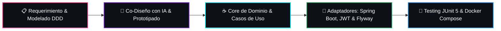

  <!-- Banner principal con gradiente fluido estilo cyber -->
  

  <!-- Subtítulo dinámico animado con enfoque corporativo y stack moderno -->
  

   
  
  &nbsp;
  
  &nbsp;
  
  &nbsp;
  

 

---

### 👨‍💻 Sobre mí

¡Hola! Soy **Leonardo Hernández**, desarrollador de software enfocado en la construcción de **arquitecturas backend robustas, desacopladas y de alta concurrencia**. Mi especialidad es el ecosistema **Java 21 LTS y Spring Boot**, diseñando soluciones estructuradas bajo principios de **Domain-Driven Design (DDD)**, **Arquitectura Hexagonal (Puertos y Adaptadores)** y control riguroso de datos con **Flyway** y **PostgreSQL**.

Complemento mi disciplina técnica integrando **Inteligencia Artificial como acelerador de ingeniería**: aplico prompts estructurados, análisis asistido y flujos agénticos para reducir fricción en el prototipado, optimizar la cobertura de pruebas unitarias y garantizar estándares de calidad exigentes en cada entrega.

* ☕ **Especialidad Backend:** Java 21, Spring Boot, Spring Security 6, JWT, Microservicios y APIs RESTful.
* 🏛️ **Buenas Prácticas:** Arquitectura Hexagonal (DDD), Código Limpio (Clean Code), Principios SOLID y Testing automatizado con JUnit 5.
* 🗄️ **Bases de Datos & DevOps:** PostgreSQL, MySQL, control de migraciones con Flyway, contenedorización con Docker / Docker Compose y entornos Linux.
* 🤖 **Ingeniería Asistida por IA:** Flujos agénticos y copilotos técnicos para elevar la velocidad y confiabilidad del software.
* 📫 **Contacto:** [lehernan.07@gmail.com](mailto:lehernan.07@gmail.com)

---

### 🛠️ Ecosistema & Stack Tecnológico

  <table border="0">
    <tr>
      <td align="center" width="40%">
        <b>☕ Backend & Arquitectura</b>
          
        
      </td>
      <td align="center" width="42%">
        <b>🗄️ Bases de Datos & DevOps</b>
          
        
      </td>
      <td align="center" width="18%">
        <b>🎨 Web Standards</b>
          
        
      </td>
    </tr>
  </table>

 

  <b>⚡ Especializaciones, Seguridad & Calidad Empresarial</b>
    
  
  &nbsp;
  
  &nbsp;
  
  &nbsp;
  
  &nbsp;
  
  &nbsp;
  
  &nbsp;
  

 

---

### ⚙️ Flujo de Ingeniería & Metodología

---

### 📊 Métricas & Actividad en GitHub

  <table border="0" width="100%">
    <tr>
      <td align="center" width="50%">
        
      </td>
      <td align="center" width="50%">
        
      </td>
    </tr>
  </table>

---

### 🚀 Proyectos Destacados

  <table border="0" width="100%">
    <tr>
      <td width="50%" align="center">
        
      </td>
      <td width="50%" align="center">
        
      </td>
    </tr>
    <tr>
      <td width="50%" align="center">
        
      </td>
      <td width="50%" align="center">
        
      </td>
    </tr>
  </table>

 

| Proyecto | Descripción & Aspectos Clave | Stack Tecnológico | Repositorio |
| :--- | :--- | :--- | :---: |
| 🏥 **Telemedicina & Triaje Clínico IA** | **Plataforma Integral de Salud Mental y Triaje Clínico con IA** • Arquitectura Hexagonal basada en Domain-Driven Design (DDD Multi-Módulo) • Seguridad Stateless robusta con Spring Security 6 y autenticación JWT • Persistencia relacional de 35+ tablas PostgreSQL con versionado estricto vía Flyway |     | [Ver Código ↗](https://github.com/Leonardo4516/telemedicina-security) |
| 🏗️ **RentaTools Marketplace** | **Plataforma B2B/B2C para Renta de Maquinaria y Equipos** • Sistema empresarial transaccional con control de flota, reservas y facturación • Control de acceso basado en roles (RBAC: Admin, Proveedor, Cliente) • Diseño modular DDD con persistencia desacoplada en PostgreSQL / MySQL |     | [Ver Código ↗](https://github.com/Leonardo4516/Proyecto_RentaHerramientas) |
| 🛡️ **Sica Project** | **Control de Acceso Vehicular & Peatonal** • Seguridad física y lógica basada en roles (RBAC) • Persistencia relacional orquestada y desplegada en Docker Compose • Suite integral de pruebas unitarias automatizadas con JUnit 5 |     | [Ver Código ↗](https://github.com/Leonardo4516/Sica_project) |
| 🗄️ **Data Pipeline PostgreSQL** | **Volcado, Normalización y Calidad de Datos** • Ingesta masiva y validación de esquema relacional geográfico (`world_db`) • Lógica de integridad referencial y funciones de negocio en PL/pgSQL • Entorno de ejecución desacoplado y reproducible en contenedores Docker |    | [Ver Código ↗](https://github.com/Leonardo4516/volcado-datos-postgresql) |

 

---

### 💡 Filosofía de Ingeniería

  
  
    

  
  &nbsp;
  
  &nbsp;
  
  &nbsp;
  

    
  <!-- Pie de página fluido con gradiente invertido -->
  

