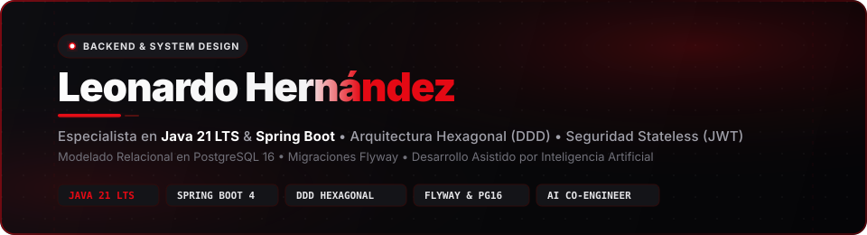
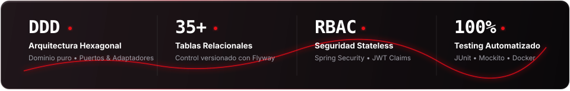
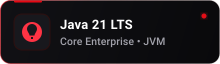
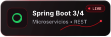
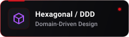
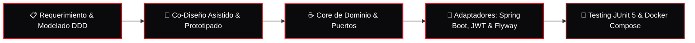

  <!-- Banner Principal en Negro Obsidiana & Carmesí -->
  

  <!-- Subtítulo Dinámico en Rojo Alta Definición -->
  

   
  <!-- Botones de Acción Estilizados en Negro y Rojo -->
  
  &nbsp;
  
  &nbsp;
  
  &nbsp;
  

 

---

### 👨‍💻 Perfil de Ingeniería

Desarrollador de software especializado en la construcción de **sistemas backend empresariales, arquitecturas desacopladas y de alta concurrencia**. Mi especialidad reside en **Java 21 LTS y el ecosistema Spring Boot**, aplicando rigurosamente **Domain-Driven Design (DDD)**, **Arquitectura Hexagonal (Puertos y Adaptadores)** y control versionado de bases de datos mediante **Flyway en PostgreSQL 16**.

Integro **Inteligencia Artificial como co-piloto activo de ingeniería**, diseñando prompts estructurados y flujos agénticos para acelerar el prototipado, garantizar exhaustividad en testing unitario (JUnit 5 / Mockito) y reducir fricción técnica sin sacrificar la solidez arquitectónica.

---

### 📈 Estándares Técnicos & Calidad de Arquitectura

  

---

### 🛠️ Ecosistema & Stack Tecnológico Especializado

  <table border="0" cellpadding="4" cellspacing="6">
    <tr>
      <td></td>
      <td></td>
      <td></td>
      <td></td>
    </tr>
    <tr>
      <td></td>
      <td></td>
      <td></td>
      <td></td>
    </tr>
    <tr>
      <td></td>
      <td></td>
      <td></td>
      <td></td>
    </tr>
  </table>

---

### ⚙️ Flujo Metodológico de Desarrollo

---

### 📊 Actividad y Medidores de Métricas en GitHub

  <table border="0" width="100%">
    <tr>
      <td align="center" width="50%">
        
      </td>
      <td align="center" width="50%">
        
      </td>
    </tr>
  </table>

---

### 🚀 Proyectos Destacados

  <table border="0" width="100%">
    <tr>
      <td width="50%" align="center">
        
      </td>
      <td width="50%" align="center">
        
      </td>
    </tr>
    <tr>
      <td width="50%" align="center">
        
      </td>
      <td width="50%" align="center">
        
      </td>
    </tr>
  </table>

 

| Proyecto | Descripción & Aspectos Clave | Stack Tecnológico | Enlaces |
| :--- | :--- | :--- | :---: |
| 🏥 **Telemedicina & Triaje Clínico IA** | **Plataforma Integral de Salud Mental y Triaje Clínico con IA** • Arquitectura Hexagonal basada en Domain-Driven Design (DDD Multi-Módulo) • Seguridad Stateless robusta con Spring Security 6 y autenticación JWT • Persistencia relacional de 35+ tablas PostgreSQL con versionado estricto vía Flyway | `Java 21 LTS` `Spring Boot` `PostgreSQL 16` `Flyway` | [Ver Código ↗](https://github.com/Leonardo4516/telemedicina-security) |
| 🏗️ **RentaTools Marketplace** | **Plataforma B2B/B2C para Renta de Maquinaria y Equipos** • Sistema empresarial transaccional con control de flota, reservas y facturación • Control de acceso basado en roles (RBAC: Admin, Proveedor, Cliente) • Diseño modular DDD con persistencia desacoplada en PostgreSQL / MySQL | `Java 21 LTS` `Spring Boot` `Spring Security 6` `Docker Compose` | [Ver Código ↗](https://github.com/Leonardo4516/Proyecto_RentaHerramientas) |
| 🛡️ **Sica Project** | **Control de Acceso Vehicular & Peatonal** • Seguridad física y lógica basada en roles (RBAC) • Persistencia relacional orquestada y desplegada en Docker Compose • Suite integral de pruebas unitarias automatizadas con JUnit 5 | `Java 17` `PostgreSQL 15` `Docker` `JUnit 5` | [Ver Código ↗](https://github.com/Leonardo4516/Sica_project) |
| 🗄️ **Data Pipeline PostgreSQL** | **Volcado, Normalización y Calidad de Datos** • Ingesta masiva y validación de esquema relacional geográfico (`world_db`) • Lógica de integridad referencial y funciones de negocio en PL/pgSQL • Entorno de ejecución desacoplado y reproducible en contenedores Docker | `PL/pgSQL` `PostgreSQL` `Docker` `Data Quality` | [Ver Código ↗](https://github.com/Leonardo4516/volcado-datos-postgresql) |

 

---

  <!-- Pie de Página Fluido en Obsidiana y Rojo Profundo -->
  

