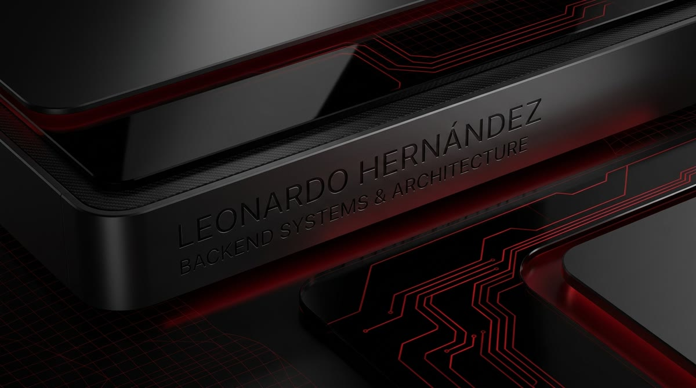
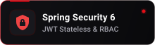
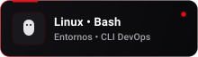
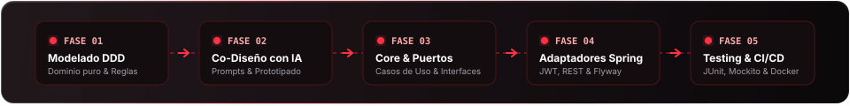
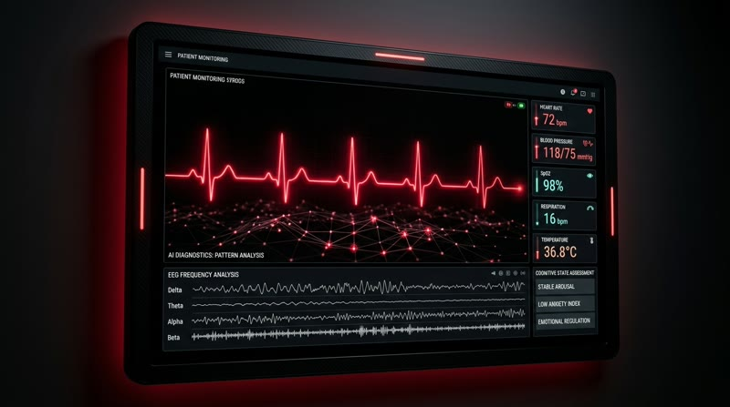
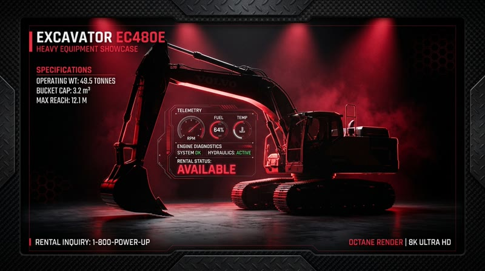
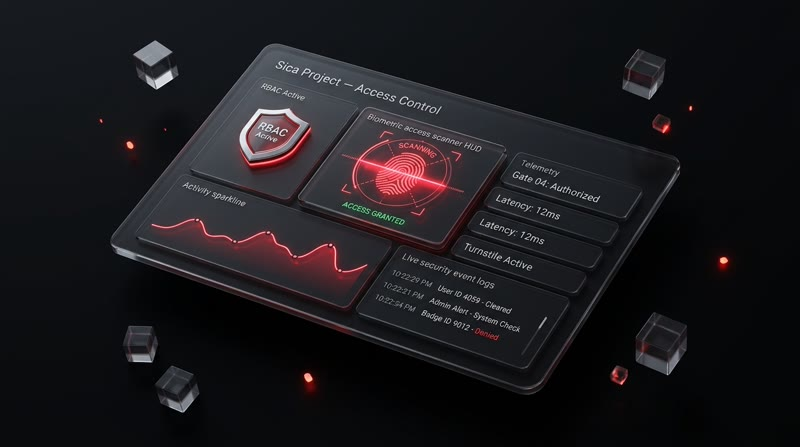
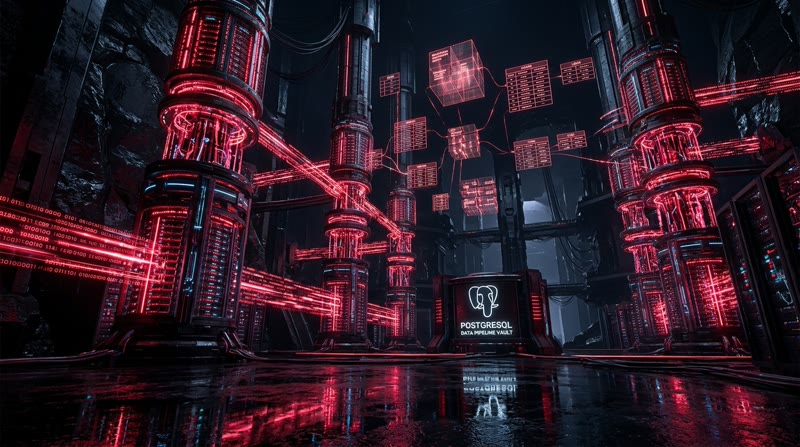

  <!-- Banner Principal: Render Cinematográfico en Negro Obsidiana & Carmesí -->
  

 

  <!-- Subtítulo Dinámico en Rojo Alta Definición (Sin números de versión) -->
  

   
  <!-- Botones de Acción Táctiles 3D (Titanio & LED Carmesí) -->
  &nbsp;&nbsp;&nbsp;&nbsp;&nbsp;&nbsp;

 

---

### 👨‍💻 Perfil de Ingeniería

Desarrollador de software especializado en la construcción de **sistemas backend empresariales, arquitecturas desacopladas y de alta concurrencia**. Mi especialidad reside en **Java y el ecosistema Spring Boot**, aplicando rigurosamente **Domain-Driven Design (DDD)**, **Arquitectura Hexagonal (Puertos y Adaptadores)** y control versionado de bases de datos mediante **Flyway en PostgreSQL**.

Integro **Inteligencia Artificial como co-piloto activo de ingeniería**, diseñando prompts estructurados y flujos agénticos para acelerar el prototipado, garantizar exhaustividad en testing unitario (JUnit / Mockito) y reducir fricción técnica sin sacrificar la solidez arquitectónica.

---

### 📈 Estándares Técnicos & Calidad de Arquitectura

  

---

### 🛠️ Ecosistema & Stack Tecnológico Especializado

  <table border="0" cellpadding="4" cellspacing="6">
    <tr>
      <td></td>
      <td></td>
      <td></td>
    </tr>
    <tr>
      <td></td>
      <td></td>
      <td></td>
    </tr>
    <tr>
      <td></td>
      <td></td>
      <td></td>
    </tr>
    <tr>
      <td></td>
      <td></td>
      <td></td>
    </tr>
  </table>

---

### ⚙️ Flujo Metodológico de Desarrollo

  

---

### 🚀 Galería de Proyectos Destacados (Showcase Visual)

  <table border="0" width="100%">
    <tr>
      <!-- Proyecto 1: Telemedicina -->
      <td width="50%" valign="top" align="center">
        
          
        <h3>🏥 Telemedicina &amp; Triaje Clínico IA</h3>
        
<b>Arquitectura Hexagonal (DDD Multi-Módulo)</b> • Seguridad Stateless con Spring Security y JWT Claims • Persistencia relacional con PostgreSQL y control versionado automatizado vía Flyway.

        

          
        

      </td>
      <!-- Proyecto 2: RentaTools -->
      <td width="50%" valign="top" align="center">
        
          
        <h3>🏗️ RentaTools Marketplace B2B/B2C</h3>
        
<b>Plataforma transaccional de renta de maquinaria pesada</b> con reservas en línea, control de ocupación de flota, seguridad por roles (RBAC) y persistencia desacoplada.

        

          
        

      </td>
    </tr>
    <tr>
      <!-- Proyecto 3: Sica Project -->
      <td width="50%" valign="top" align="center">
        
          
        <h3>🛡️ Sica Project — Control de Acceso</h3>
        
<b>Control integral de acceso vehicular y peatonal</b> con seguridad por perfiles (RBAC), entorno orquestado con Docker Compose y suite de pruebas unitarias automatizadas con JUnit y Mockito.

        

          
        

      </td>
      <!-- Proyecto 4: Data Pipeline -->
      <td width="50%" valign="top" align="center">
        
          
        <h3>🗄️ Data Pipeline &amp; Calidad de Datos</h3>
        
<b>Ingesta, volcado y normalización masiva de datos geográficos</b> (`world_db`) mediante procedimientos PL/pgSQL, validación de integridad referencial y ejecución en Docker.

        

          
        

      </td>
    </tr>
  </table>

---

### 📊 Actividad y Medidores de Métricas en GitHub

  
  

 

---

  <!-- Pie de Página Fluido en Obsidiana y Rojo Profundo -->
  

